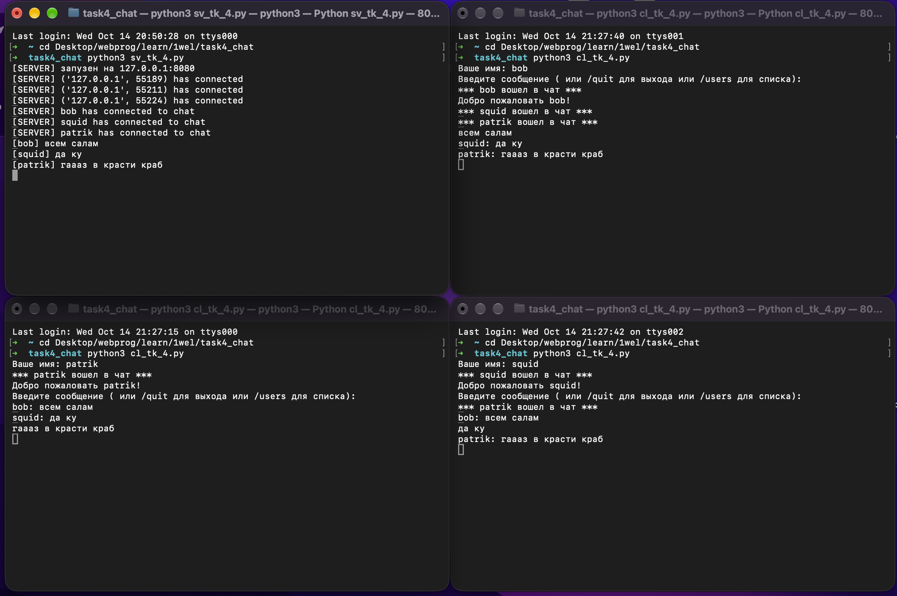

---

## 📄 `docs/task4.md` — многопользовательский чат

# Задание 4. Многопользовательский чат (TCP)

## Постановка

Многопользовательский чат с идентификацией пользователей и возможностью выхода.

**Требования:**
- Библиотека `socket`
- `threading` для многопользовательского чата
- Идентификация пользователей
- Возможность выхода

**Реализация:** TCP — 100% баллов.

## Архитектура

- Главный поток — `accept()` в цикле.
- На каждого клиента — **отдельный поток** (`threading.Thread`).
- Общий словарь `clients = {socket: username}` защищён `Lock`.
- Идентификация — имя передаётся **первым сообщением**.
- Выход — команда `/quit` или закрытие сокета.

## Код сервера `sv_tk_4.py`

```python
import socket
import threading

HOST = "127.0.0.1"
PORT = 8080

clients = {}
clients_lock = threading.Lock()

def broadcast(msg: str, sender_sock=None):
    data = (msg + '\n').encode("utf-8")
    with clients_lock:
        targets = list(clients.keys())
    for sock in targets:
        if sock is sender_sock:
            continue
        try:
            sock.sendall(data)
        except OSError:
            remove_client(sock)

def remove_client(sock):
    with clients_lock:
        name = clients.pop(sock, None)
    if name:
        print(f"[SERVER] {name} has disconnected")
        broadcast(f"*** {name} покинула чат ***")
    try:
        sock.close
    except OSError:
        pass

def handle_client(sock, addr):
    print(f"[SERVER] {addr} has connected")
    try:
        name = sock.recv(1024).decode("utf-8").strip()
        if not name:
            name = f"user_{addr}"

        with clients_lock:
            clients[sock] = name

        print(f"[SERVER] {name} has connected to chat")
        broadcast(f"*** {name} вошел в чат ***")
        sock.sendall(f"Добро пожаловать {name}!\n".encode("utf-8"))


        while True:
            data = sock.recv(4096)
            if not data:
                break
            text = data.decode("utf-8").strip()
            if not text:
                continue

            if text == "/quit":
                break
            if text == "/users":
                with clients_lock:
                    names = ", ".join(clients.values())
                sock.sendall(f"В чате {names}!\n".encode("utf-8"))
                continue


            print(f"[{name}] {text}")
            broadcast(f"{name}: {text}", sender_sock=sock)
    except (ConnectionResetError, OSError):
        pass
    finally:
        remove_client(sock)


def main():
    server_sock = socket.socket(socket.AF_INET, socket.SOCK_STREAM)
    server_sock.setsockopt(socket.SOL_SOCKET, socket.SO_REUSEADDR, 1)
    server_sock.bind((HOST, PORT))
    server_sock.listen(10)
    print(f"[SERVER] запузен на {HOST}:{PORT}")

    try:
        while True:
            client_sock, client_addr = server_sock.accept()
            t = threading.Thread(
                target=handle_client,
                args=(client_sock, client_addr),
                daemon = True,
            )
            t.start()
    except KeyboardInterrupt:
        print(f"\n[SERVER] остановка")
    finally:
        server_sock.close()


if __name__ == "__main__":
    main()
```

## Код клиента `cl_tk_4.py`

```python
import socket
import threading
import sys

HOST = "127.0.0.1"
PORT = 8080

def receive_loop(sock):
    while True:
        try:
            data = sock.recv(4096)
            if not data:
                print(f"\n[SERVER] соединение закрыто")
                break
            print(data.decode("utf-8"), end="")
        except OSError:
            break
    sys.exit(0)


def main():
    sock = socket.socket(socket.AF_INET, socket.SOCK_STREAM)
    sock.connect((HOST, PORT))

    name = input("Ваше имя: ").strip() or "anon"
    sock.sendall((name + '\n').encode("utf-8"))

    t = threading.Thread(
        target=receive_loop,
        args=(sock,),
        daemon=True
    )
    t.start()

    print(f"Введите сообщение ( или /quit для выхода или /users для списка):")
    try:
        while True:
            msg = input()
            if not msg:
                continue
            sock.sendall((msg + '\n').encode("utf-8"))
            if msg == "/quit":
                break
    except (KeyboardInterrupt, OSError):
        pass
    finally:
        sock.close()
        print("Вы вышли из чата(")

if __name__ == "__main__":
    main()
```

## Результат
Четыре терминала: сервер + Patrik + Squid + Bob. Сообщения одного видны у других, работает /users и /quit.



