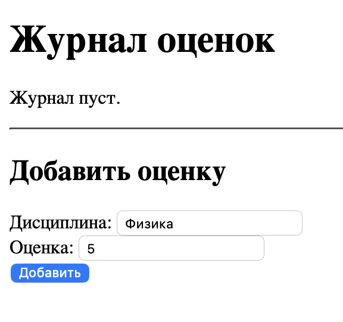
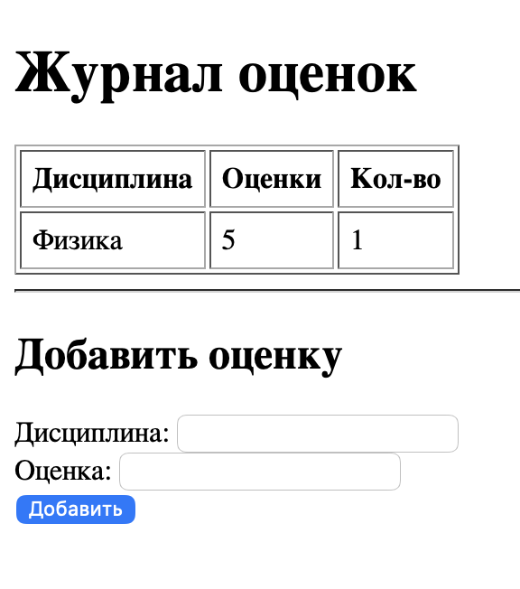
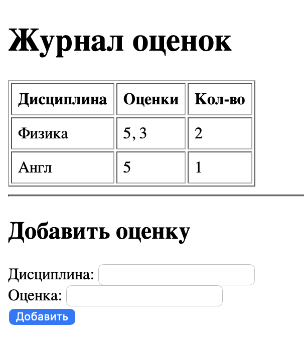

---

## 📄 `docs/task5.md` — веб-сервер с журналом

# Задание 5. Простой веб-сервер (GET/POST)

## Постановка

Сервер принимает `discipline` и `grade` через POST и отдаёт HTML-журнал, **сгруппированный по дисциплине**.

**Структура данных:** словарь `{дисциплина: [оценки]}`.

## Архитектура

- Разбор HTTP-запроса вручную: request line → метод, URL, версия.
- Заголовки — через `email.Parser`.
- Тело — по `Content-Length`.
- POST → `setdefault(discipline, []).append(grade)` → редирект `303 See Other` на `/`.
- GET → сборка HTML-таблицы из словаря.

## Код сервера `web_server.py`

```python
import socket
import sys
from urllib.error import HTTPError
from urllib.parse import  parse_qs, urlparse
from email.parser import Parser
from html import escape


MAX_LINE = 64*1024
MAX_HEADERS = 100


class MyHTTPServer:
    def __init__(self, host, port, server_name):
        self._host = host
        self._port = port
        self._server_name = server_name
        self._journal = {}


    def serve_forever(self):
        serv_sock = socket.socket(socket.AF_INET, socket.SOCK_STREAM,proto=0)
        serv_sock.setsockopt(socket.SOL_SOCKET, socket.SO_REUSEADDR, 1)
        try:
            serv_sock.bind((self._host, self._port))
            serv_sock.listen(10)
            print(f"Сервер запущен на http://{self._host}:{self._port}")
            while True:
                conn, _ = serv_sock.accept()
                try:
                    self.serve_client(conn)
                except Exception as e:
                    print("Ошибка при обслуживарнии клиента:", e)
        finally:
            serv_sock.close()


    def serve_client(self, conn):
        try:
            req = self.parse_request(conn)
            resp = self.handle_request(req)
            self.send_response(conn, resp)
        except ConnectionResetError:
            conn = None
        except Exception as e:
            self.send_error(conn, e)
        finally:
            if conn:
                conn.close()

    def parse_request(self, conn):
        rfile = conn.makefile('rb')  # ← создаём ОДИН раз

        # --- request line ---
        raw = rfile.readline(MAX_LINE + 1)
        if not raw:
            raise Exception("Пустой запрос")
        if len(raw) > MAX_LINE:
            raise Exception("Request line слишком длинная")

        req_line = raw.decode('iso-8859-1').rstrip('\r\n')
        words = req_line.split()
        if len(words) != 3:
            raise Exception("Некорректная request line")
        method, target, ver = words
        if ver != 'HTTP/1.1':
            raise Exception("Только HTTP/1.1")

        # --- заголовки ---
        headers = self.parse_headers(rfile)

        # --- Host ---
        host = headers.get('Host', '').strip()
        if not host:
            raise Exception("Нет Host")

        # --- тело (по Content-Length) ---
        body = b''
        size = headers.get('Content-Length')
        if size:
            try:
                size = int(size)
                body = rfile.read(size)
            except ValueError:
                raise Exception("Плохой Content-Length")

        rfile.close()  # ← ОБЯЗАТЕЛЬНО

        return {
            'method': method,
            'target': target,
            'path': urlparse(target).path,
            'query': parse_qs(urlparse(target).query),
            'headers': headers,
            'body': body,
        }

    def parse_headers(self, rfile):
        lines = []
        count = 0
        while True:
            line = rfile.readline(MAX_LINE + 1)
            if not line:
                break
            if len(line) > MAX_LINE:
                raise Exception("Строка заголовка слишком длинная")
            if line in (b'\r\n', b'\n'):  # ← пустая строка = конец
                break
            lines.append(line)
            count += 1
            if count > MAX_HEADERS:
                raise Exception("Слишком много заголовков")

        sheaders = b''.join(lines).decode('iso-8859-1')
        return Parser().parsestr(sheaders)


    def read_body(self, headers, rfile):
        size = headers.get('Content-Length')
        if not size:
            return b''
        try:
            size = int(size)
        except ValueError:
            raise Exception("Некорректный Content-Length")
        return rfile.read(size)


    def handle_request(self, req):
        method = req['method']
        path = req['path']

        if path == '/':
            if method == 'GET':
                return self.handle_get(req)
            if method == 'POST':
                return self.handle_post(req)

        raise Exception("Not found")

    def handle_post(self, req):
        params = dict(req['query'])

        body = req.get('body', b'')
        if body:
            try:
                text = body.decode('utf-8')
                body_params = parse_qs(text)
                params.update(body_params)
            except UnicodeDecodeError:
                pass

        discipline = params.get('discipline', [None])[0]
        grade = params.get('grade', [None])[0]

        if not discipline or not grade:
            raise Exception("Нужны параметры discipline и grade")

        discipline = discipline.strip()
        grade = grade.strip()

        self._journal.setdefault(discipline, []).append(grade)

        # --- РЕДИРЕКТ НА ГЛАВНУЮ ---
        headers = [
            ('Location', '/'),
            ('Content-Length', 0),
        ]
        return (303, 'See Other', headers, b'')

    def handle_get(self, req):
        rows = []
        for discipline, grades in self._journal.items():
            grades_str = ", ".join(escape(g) for g in grades)
            rows.append(
                f"<tr><td>{escape(discipline)}</td>"
                f"<td>{grades_str}</td>"
                f"<td>{len(grades)}</td></tr>"
            )

        if rows:
            table = (
                "<table border='1' cellpadding='6'>"
                "<tr><th>Дисциплина</th><th>Оценки</th><th>Кол-во</th></tr>"
                + "".join(rows) +
                "</table>"
            )
        else:
            table = "<p>Журнал пуст.</p>"

        html = f"""<!DOCTYPE html>
<html lang="ru">
<head>
    <meta charset="UTF-8">
    <title>Журнал оценок</title>
</head>
<body>
    <h1>Журнал оценок</h1>
    {table}
    <hr>
    <h2>Добавить оценку</h2>
    <form method="POST" action="/">
        <label>Дисциплина: <input type="text" name="discipline" required></label><br>
        <label>Оценка: <input type="text" name="grade" required></label><br>
        <button type="submit">Добавить</button>
    </form>
</body>
</html>"""

        body = b'\xef\xbb\xbf' + html.encode('utf-8')
        headers = [
            ('Content-Type', 'text/html; charset=utf-8'),
            ('Content-Length', len(body)),
        ]
        return (200, 'OK', headers, body)


    def send_response(self, conn, resp):
        status, reason, headers, body = resp

        wfile = conn.makefile('wb')
        status_line = f'HTTP/1.1 {status} {reason}\r\n'
        wfile.write(status_line.encode('iso-8859-1'))

        if headers:
            for key, value in headers:
                header_line = f'{key}: {value}\r\n'
                wfile.write(header_line.encode('iso-8859-1'))

        wfile.write(b'\r\n')

        if body:
            wfile.write(body)

        wfile.flush()
        wfile.close()


    def send_error(self, conn, err):
        status = 500
        reason = 'Internal Server Error'
        body = str(err).encode("utf-8")

        if isinstance(err, HTTPError):
            status = err.status
            reason = err.reason
            body = (err.body or err.reason).encode("utf-8")

        headers = [('Content-Length', len(body))]
        self.send_response(conn, (status, reason, headers, body))


class HTTPError(Exception):
    def __init__(self, status, reason, body=None):
        super().__init__(reason)
        self.status = status
        self.reason = reason
        self.body = body


if __name__ == '__main__':
    host = sys.argv[1] if len(sys.argv) > 1 else '127.0.0.1'
    port = int(sys.argv[2] if len(sys.argv) > 2 else 53210)
    name = sys.argv[3] if len(sys.argv) > 3 else 'example.local'

    serv = MyHTTPServer(host, port, name)
    try:
        serv.serve_forever()
    except KeyboardInterrupt:
        print("\nОстановка сервера")
```
## Результат страница `127.0.0.1:53210`
Пример добавления оценки


Несколько оценок



